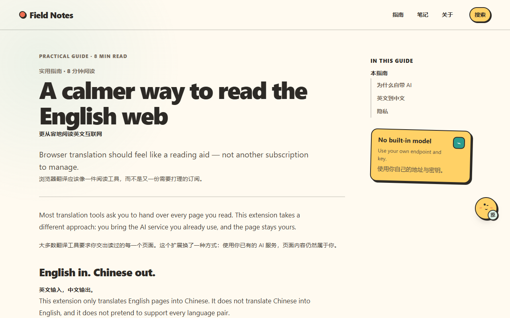
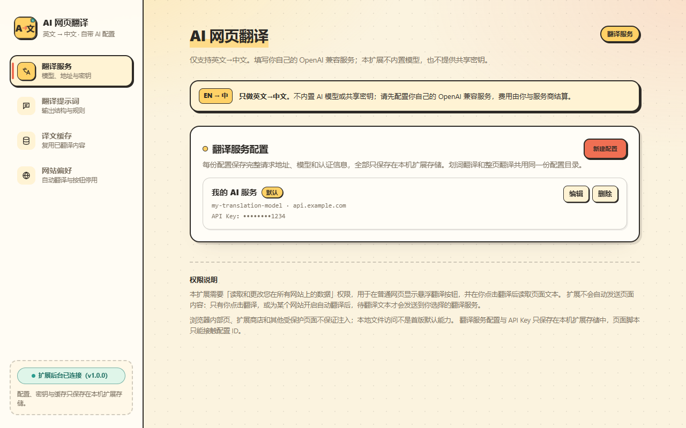
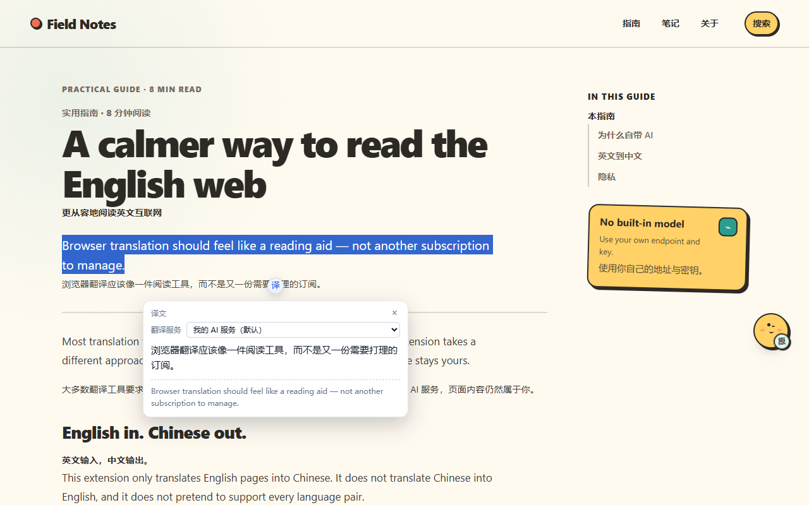

# AI 网页翻译 · 英文转中文

一个使用 **你自己的 AI 服务** 把英文网页翻译成中文的浏览器扩展。

- 只支持英文 → 中文，不提供中文 → 英文或其他语言对。
- 不内置 AI 模型、免费额度或共享 API Key。
- 支持整页双语、划词翻译、界面文本翻译与按网站自动翻译。
- 基于 Manifest V3、TypeScript、WXT 与 React。

> 截图来自生产构建 + 本地演示 AI 服务，示例配置使用占位域名和演示 Key；实际使用时请替换为你自己的服务。

<p align="center">
  
</p>

## 功能

### 整页双语

保留英文原文与页面结构，在段落、列表项、标题和表格单元格下方插入中文译文。再次点击悬浮按钮即可恢复原文。

### 划词翻译

选中英文句子后点击选区图标，在气泡中查看中文译文；长选区会拆成多个单元，按原文顺序显示。

### 界面文本翻译

导航、按钮、菜单项和表单标签优先显示中文，悬停可查看英文原文；输入框、图标和页面事件保持原位。

### 自带 AI 服务

在设置页填写任意兼容 OpenAI Chat Completions 的地址、模型和 API Key；可以保存多份配置并切换默认项。

<p align="center">
  
</p>

### 其他

- 动态内容：页面新增内容或原文变化后自动处理。
- 代码保护：代码块和行内代码保持英文，不进入翻译请求。
- 可编辑提示词、译文缓存、并发/超时/重试设置。
- 按完整域名自动翻译；可永久关闭某个网站的悬浮按钮。
- 设置页与浮层支持深色模式、键盘操作和减少动态效果。

<p align="center">
  
</p>

## 环境要求

- Node.js 20+（开发时使用 Node 24 验证）
- npm
- Chrome / Edge 等支持 Manifest V3 的桌面浏览器

## 本地运行

```bash
npm install
npm run dev
```

WXT 会启动开发模式；按终端提示在 Chrome 或 Edge 中加载开发版扩展。

生产构建：

```bash
npm run build
```

构建产物位于 `.output/chrome-mv3`。

### 加载到浏览器

1. Chrome 打开 `chrome://extensions`，Edge 打开 `edge://extensions`。
2. 打开「开发者模式」。
3. 选择「加载已解压的扩展程序」。
4. 指向 `ai-web-translation/.output/chrome-mv3`。
5. 打开任意 HTTP/HTTPS 英文网页，右侧会出现悬浮翻译按钮。

> 系统 Chrome 137+ 不再接受 `--load-extension` 命令行参数，因此自动化测试不直接加载系统 Chrome；手动加载不受影响。本仓库不包含测试代码。

## 配置 AI 服务

1. 点击扩展图标，或点击悬浮按钮面板里的「设置」。
2. 打开「翻译服务」→「新建配置」。
3. 填写：
   - 名称，例如「我的 AI 服务」
   - 完整 Chat Completions 地址，例如 `https://api.example.com/v1/chat/completions`
   - 模型名
   - API Key（如服务商需要）
4. 保存后设为默认配置；可以先点「测试连接」确认请求能成功。
5. 打开英文网页，点击悬浮按钮开始整页翻译；选中文字可划词翻译。

> 只填基础地址（例如 `https://api.example.com/v1`）也可以，扩展会自动补全 `/chat/completions`。本机回环地址允许使用 HTTP，远程地址需要使用 HTTPS。

## 隐私

- API Key、服务配置、提示词、译文缓存、网站偏好与按钮位置只保存在本机扩展存储中。
- 只有你主动翻译，或为某个网站开启自动翻译后，页面英文文本和必要的翻译上下文才会发送到**你自己配置的 AI 服务地址**。
- 扩展不使用分析、广告或遥测，不把数据发送给扩展开发者。
- 代码块、脚本、样式、隐藏内容和用户输入不会被提交翻译。

## 项目结构

```text
src/
├─ entrypoints/
│  ├─ background.ts          # 后台 Engine、配置、缓存与 HTTP
│  ├─ content/               # 内容脚本入口与页面装配
│  └─ options/               # React 设置页
├─ modules/
│  ├─ translation-engine/    # 批次、并发、超时、重试、取消
│  ├─ translation-chat-completions/ # OpenAI 兼容请求与响应
│  ├─ page-translation/      # 整页翻译会话、渲染与恢复
│  ├─ selection-translation/ # 划词翻译与译文气泡
│  ├─ content-scan/          # 正文与界面文本识别
│  ├─ inline-format/         # 行内格式与安全渲染
│  └─ floating-button/       # 悬浮按钮与面板
└─ shared/                   # 共享类型、文本与标记工具
```

## 已知限制

- 正文单元按段落级识别，复杂网页仍在持续适配。
- 浏览器内部页、扩展商店等受保护页面无法注入。
- 翻译质量、速度与费用由你配置的 AI 服务决定。
- 只支持英文网页翻译成中文。

## 反馈

欢迎通过 GitHub Issues 反馈问题或建议。请勿在 Issue 中粘贴 API Key、页面隐私内容或其他敏感信息。
